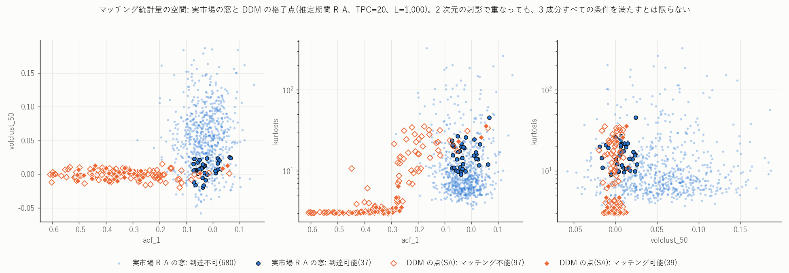

# DDM の到達可能な市場統計領域と実市場の窓 — 結果報告(A0・A1・B・C-min・D)

- 日付: 2026-11-26
- 計画: `docs/research-ddm-reachable-region-plan.md` v0.6(承認版 commit `0c1cbce`)
- 中断の記録(2 回の中断と続行の承認): `docs/research-ddm-reachable-region-stoplog.md`
- 実施範囲: A0、A1、B、C-min(到達可能性まで)、D。**A2-0・A2・A3 は未実施(未承認)。**

> **すべての結果に付く条件**: A1 の再現性の基準(SA と SB の M の一致 80% 以上)は**不合格(75.7%)**であり、逸脱として記録して続行した。到達可能な DDM の点が SA と SB で一致するか(Jaccard ≥ 0.8)も**不合格(0.0)**。以下は、この条件の下の記述結果である。

## 1. 要約

1. 推定期間の実市場の窓(R-A、717 窓)のうち、DDM の格子点で到達可能な窓は **37(5.2%)**。95% 近くは到達可能でなかった。
2. 残差分析の条件は、5% 以上と 20 週以上は満たしたが、**50 窓以上を満たさない**。そのため **E の残差、ノイズ床との比較は行っていない**(H3・H4 は評価していない)。
3. **どの窓・どの点が到達可能かは安定しない。** SA と SB で、到達可能な点は 1 つも一致せず、到達可能な窓の重なりは 13(SA 37、SB 44)。
4. 割合が小さいという向きは、検証期間(2.3%)、SA/SB の入れ替え(6.1%)、単位の組み合わせ(0〜6.7%)、L=4,000(0%)でも同じだった。マッチング統計量を変える感度分析では高くなる(PB 16.0%、PC 28.7%)。
5. 最も大きい差はボラティリティ・クラスタリング。DDM の `volclust_50` は全点で −0.020〜+0.015、実市場の中央値は 0.050。**窓の 62% は、マッチング資格の判定に関係なく、この成分だけで届かない**(事後分析。全 10 seed が成功した点に限る)。

> **注記(2026-11-26 追記)**
> - 「窓の 62〜65%」は、実市場の**個々の窓**を、DDM の**点平均**の範囲(± caliper)と比べた値である。
> - DDM の個々の窓は、点平均より大きくばらつく。
> - したがって、**個々の窓が DDM から生成され得ないという証拠ではない。**「実市場の多くの窓の値に届かない」という記述も、点平均の範囲についての記述として読む。
> - Phase 8b(Study Manager #32)では、異なる定義でクラスタリングの欠如が観察されている。ただし、今回の窓内の `volclust_50` を直接に再現確認したものではない。

## 2. 逸脱と、事前の基準の判定

| 段階 | 基準 | 結果 | 扱い |
|---|---|---|---|
| A1 | CPU 時間 15.2 以内 | **35.3**(失敗 run が 29.5)。超過の時点で停止しなかった | 逸脱。続行を承認(1 回目) |
| A1 | `N_grid` ≥ 60(中止は 30 未満) | 136 / 176 | 合格 |
| A1 | 発散率 50% 以下 | 9.5% | 合格 |
| A1 (i) | 発散率が既存から大きくずれない(数値基準なし) | 失敗を含む点 40 / 176(既存アトラスは 11 / 176。5 seed・2 万約定で条件が違う) | 判定せず |
| A1 (ii) | SA/SB の M の一致 ≥ 80% | **75.7%** | **不合格**。逸脱として続行を承認(2 回目) |
| A1 (iii) | 到達可能な点の Jaccard ≥ 0.8 | **0.0**(SA 3 点、SB 1 点) | **不合格**。上の続行の範囲で併記 |
| B | R-A・R-B 各 300 窓以上 | 717 / 719 | 合格 |
| B | ATR 群ごとに各 100 窓以上 | 群 0 の R-A が 75 | 群 0 は層別分析の対象外(記述のみ) |
| B | ノイズ床に使える R-B 窓 100 以上 | 648(`f_0j` は 0.052〜0.056) | 合格 |
| C-min | ≥ 5%、≥ 50 窓、≥ 20 週 | 5.2%、**37 窓**、34 週 | **残差分析に進まない** |
| D | 主結果の向きが一致 | 割合が小さく残差分析の条件を満たさない向きは一致。窓と点は一致しない | §5 |

SA/SB の基準には設計の誤りがあった。10 run を無作為に 5/5 に分け直すと、seed のばらつきだけでも一致割合は平均 79.7%(90% の範囲 74.3〜85.3%)で、約半分が不合格になる(事後分析。判定は変えない)。誤差幅の倍率(2)は計画になく、解析コードの作成時(結果を見る前)に決めた。

そのほかの実装上の具体化と差異:

- §12 の事前確認事項は計画の既定値で確定(実行後に、1 回目の続行の承認で確定)。
- 1 run は 100,001 約定。取引週は「時刻 + 6 時間」の ISO 週。300 秒超の欠損で窓を切り、ゼロ収益率の割合が 0.30 超の窓を除外(除外 0)。ATR 4 群は既存の 20 バケットの境界を 5 つずつまとめた。
- 尖度のフォールバックの分母は `N_grid`。初期過渡の規則は、DDM 精度資格の点が 0 のため対象がなく「除外しない」(全 136 点で数えても 0.7〜5.1% で基準未満)。
- PB の E に尖度と分位点比の両方を含めた(A1 解析の実行前に修正)。
- 単位の組み合わせと L=4,000 では、`SD_j`・`c_j` を各窓定義の R-A から計算し直した。

## 3. A0・A1: DDM 側

- A0(既存アトラスの再解釈): 170 点が有効。seed 間 SE が点間 SD の 0.25 倍以下の点の割合は、`acf_1` 0.85、尖度 0.81、`volclust_50` 0.006。
- A1: 1,593 / 1,760 run が成功。失敗は wma 1〜3 に集中し、8 点(wma=1、delta −1.5〜−0.8)は全 seed が失敗。8 run の再生成は一致。
- M の範囲(136 点、SA の点平均): `acf_1` −0.61〜+0.06(中央値 −0.31)、尖度 3.0〜35.5(中央値 3.3)、`volclust_50` −0.020〜+0.015。
- `acf_1` と尖度は連動する(点間のスピアマン相関 0.86)。`volclust_50` はほとんど動かず、他の統計量とほぼ無相関。H1 のうち「ボラティリティ・クラスタリングも連動して動く」は観察されなかった。
- **DDM 精度資格(`SE ≤ 0.25 × SD_grid`)を満たす点は 0**(`volclust_50` の合格が 0%)。このため A2-0・A3 の点選択の規則は、現状では適用できない。
- 集約幅(TPC 10 / 20 / 40、H2'・探索): 中央値は `acf_1` −0.29 / −0.31 / −0.36、尖度 3.50 / 3.31 / 3.22。

## 4. C-min: 到達可能性(推定期間 R-A)

caliper は `c_j = 0.5 × SD_j`: `acf_1` 0.029、尖度 14.1、`volclust_50` 0.022。

| 項目 | 値 |
|---|---|
| マッチング資格を満たす点 | 39 / 136(**71% は判定不能**) |
| 到達可能な窓(箱型) | **37 / 717(5.2%)**、34 / 105 週 |
| 到達可能な窓(ユークリッド 0.5、より厳しい) | 2.8% |
| 最近傍点までの距離(チェビシェフ、SD 単位)の中央値 | 1.13(基準は 0.5) |
| ATR 群 0 / 1 / 2 / 3 | 8.0%(75 窓、参考)/ 4.1% / 4.8% / 6.0% |
| 時間帯別(開始時刻、50 窓以上の時刻) | 2.1〜9.4% |

**到達を妨げる成分**

| 成分 | その成分の caliper を外したときの割合 | 最近傍点で最も外れる成分だった窓数 | 実市場の窓のうち DDM の範囲内 |
|---|---|---|---|
| `acf_1` | 35.4% | 136 | 93.4% |
| 尖度 | 16.0% | 152 | 90.8% |
| `volclust_50` | 20.2% | 429 | **13.7%** |

指標で順位が変わる。外したときの増加は `acf_1` が最大、最近傍点からのずれと範囲の外れは `volclust_50` が最大。3 成分とも制約になっている。

**到達可能な窓は典型的な窓ではない**

| 中央値 | R-A 全体 | 到達可能な 37 窓 |
|---|---|---|
| `acf_1` | −0.026 | −0.037 |
| 尖度 | 8.5 | 15.5 |
| `volclust_50` | 0.050 | 0.0075 |

- 37 窓のうち **27 窓(73%)は 1 点**(delta −0.3、wma 2)が担う。残りは (0.0, 1) が 9、(−0.2, 1) が 1。
- この 3 点は、多くの run が失敗する wma ≤ 3 の領域にある。
- **尖度のマッチングは緩い。** caliper 14.1 は R-A の尖度の中央値より大きい(重い裾で窓間 SD が 28 になるため)。到達可能な窓の尖度の中央値 15.5 に対し、対応する DDM は 23.1。

## 5. D: 頑健性

| 条件 | 到達可能な窓 | 割合 |
|---|---|---|
| 主(R-A) | 37 / 717 | 5.2% |
| 検証期間(凍結した規則) | 8 / 351 | 2.3% |
| SA/SB の入れ替え | 44 / 717 | 6.1% |
| 08〜17 時開始の窓 | 15 / 306 | 4.9% |
| 暦年別(2016〜2020) | — | 3.3〜7.7% |
| PB(M = `acf_1`, `volclust_50`)感度 | 115 / 717(70 週) | 16.0% |
| PC(M = VR(20), 尖度)感度 | 206 / 717(89 週) | 28.7% |
| L=4,000(TPC 10 / 20) | 0 / 103 | 0%(資格を満たす点が 1 / 4 しかなく、精度の制約が支配的) |

| 到達可能な割合 | 1 分足 | 2 分足 | 5 分足 |
|---|---|---|---|
| TPC 10 | 1.5%(11 / 717) | 1.3%(4 / 307) | 0%(0 / 100) |
| TPC 20 | 5.2%(37 / 717) | 5.9%(18 / 307) | 2.0%(2 / 100) |
| TPC 40 | 6.7%(48 / 717) | 3.9%(12 / 307) | 0%(0 / 100) |

PB・PC は、数値上は残差分析の条件(50 窓、20 週)を超えるが、感度分析であり主結論には使わない。残差分析は実行していない。

## 6. 補足(計画にある記述項目)

**集約プロファイル**(窓ごとの中央値。DDM は SA の全 3,400 窓、実市場は R-A の 717 窓)

| 基底足の倍率 | `acf_1` DDM / 実 | 尖度 DDM / 実 |
|---|---|---|
| 1 | −0.325 / −0.026 | 3.27 / 8.45 |
| 2 | −0.350 / −0.036 | 3.22 / 7.11 |
| 4 | −0.384 / −0.029 | 3.14 / 5.95 |

DDM は集約すると負の自己相関が強まる。実市場はほぼ変わらない。

**標準偏差の比(H1s、到達可能な 37 窓)**: 実市場 ÷ 対応する DDM は、10% 点 0.040、中央値 0.105、90% 点 0.192(上下で 4.8 倍)。1 つの定数倍では揃わない。37 窓の多くが 1 点に対応するため、DDM 側との相関(−0.02)は解釈できない。

## 7. 事後分析(結果を見た後に追加。判定は変えない)

- **SA/SB で点が一致しない理由**: SA で到達に使われた 3 点は SB では資格を失い、SB の 1 点は SA で資格がない。1 点は `volclust_50` の SE が caliper の 0.502 倍(基準 0.5)という僅差だった。
- **資格の判定を外した場合**: 到達可能な窓は SA 93(13.0%)、SB 97(13.5%)。SA/SB の窓の Jaccard は 0.48、点の Jaccard は 0.55。割合は小さいままで、一致も不十分。
- **資格で主に落ちる成分**は `acf_1`(合格 31% / 40%)。
- **範囲だけで届かない窓**(全 10 seed 成功の 136 点の範囲 ± caliper の外): SA 64.6%、SB 67.8%。内訳は `volclust_50` が 62.2% / 65.1%(上限 0.037 / 0.033)、`acf_1` 1.5% / 5.0%、尖度 5.9% / 3.6%。失敗を含む 40 点の範囲は含まない。

> **注記(2026-11-26 追記)**
> - 「窓の 62〜65%」は、実市場の**個々の窓**を、DDM の**点平均**の範囲(± caliper)と比べた値である。
> - DDM の個々の窓は、点平均より大きくばらつく。
> - したがって、**個々の窓が DDM から生成され得ないという証拠ではない。**「実市場の多くの窓の値に届かない」という記述も、点平均の範囲についての記述として読む。
> - Phase 8b(Study Manager #32)では、異なる定義でクラスタリングの欠如が観察されている。ただし、今回の窓内の `volclust_50` を直接に再現確認したものではない。

## 8. 言えることと、言えないこと

仮説ごとの扱い: **H1** は、実市場の窓の大部分が領域の外という点では整合的だが、領域の推定が安定せず、`volclust_50` が他と連動して動くという部分は観察されなかった(確定しない)。**H1s** は §6。**H2'** は §3・§5 の記述のみ。**H2・H3・H4 は評価していない。**

- **言える(記述)**: `num_agent=300`・ショックなし・delta と wma の格子では、USDJPY の 1 分足の窓のうち、3 つの統計量を同時に揃えられるものは少ない。DDM の `volclust_50` は 0 付近にとどまり、実市場の多くの窓の値に届かない。
- **言えない**: 到達可能な領域の境界や、どの窓が到達可能かは特定できていない(SA/SB で不一致、点の 71% が判定不能)。DDM がこのモデル族で原理的に届かないとは言えない(追加パラメータは未探索、失敗点は除外)。到達可能な窓での E の一致・不一致は調べていない。
- 統計量が一致しても、DDM の市場生成機構が実市場を再現したことにはならない。TPC 20 と 1 分足の対応は慣習で、実時間の対応ではない。

> **注記(2026-11-26 追記)**
> - 「窓の 62〜65%」は、実市場の**個々の窓**を、DDM の**点平均**の範囲(± caliper)と比べた値である。
> - DDM の個々の窓は、点平均より大きくばらつく。
> - したがって、**個々の窓が DDM から生成され得ないという証拠ではない。**「実市場の多くの窓の値に届かない」という記述も、点平均の範囲についての記述として読む。
> - Phase 8b(Study Manager #32)では、異なる定義でクラスタリングの欠如が観察されている。ただし、今回の窓内の `volclust_50` を直接に再現確認したものではない。

## 9. 未実施

- C-min の残差分析一式(E の残差、ノイズ床との比較、ブートストラップ、E|M の比較、DDM 同士・Student-t・GARCH の対照、検証期間の残差)。条件を満たさないため。該当するコードの一部は未実装。
- 窓内ブロックブートストラップによる推定誤差、上位 1% の窓を除く感度分析(§6.5)。除外の指標とブロック長が計画で定まっていない。
- M の空間のクラスタ(探索の補助)、集約プロファイルの VR。
- D の他の通貨ペア。L=4,000 の 2 分足・5 分足は、1 取引週に収まらず実行できない。
- A2-0・A2・A3(未承認)。

## 10. レビューで決める事項

- 本研究をこの記述結果で終えるか。
- A2 以降に進む場合は、計画の改訂が必要: SA/SB の基準の作り直し、`volclust_50` の精度(DDM 精度資格が 0 点)、尖度の caliper の緩さ、失敗 run の時間を含む予算の見積り。いずれも結果を見た後の変更になるため、改訂版で明示して承認を得る。

## 11. 再現情報

`backend/research/ddm_reach/` で次の順に実行する(`dr_tables.py` 以外は、未コミットの変更があると停止する)。

| コマンド | 実行時の commit | 出力(`results/`) |
|---|---|---|
| `python dr_a0.py` | `fd3c153` | `a0.json` |
| `python dr_a1_gen.py` | `36bf42e` | `a1_gen.json`、`a1_meta.jsonl` |
| `python dr_b_windows.py` | `cc02097` | `b_windows_L1000_bar1.csv`、`b_windows_summary.json` |
| `python dr_a1_stats.py` → `dr_a1_analysis.py` | `d18e9e5` | `a1_points.csv`、`a1_analysis.json`、`a1_decisions.json` |
| `python dr_a1_gate_posthoc.py` | `63f9963` | `a1_gate_posthoc.json` |
| `python dr_b_rules.py` | `f7a5d9a` | `frozen_rules.json`(DDM と実市場の比較の前にコミット: `a9ec551`) |
| `python dr_c_min.py --reach-only` | `a9ec551` | `c_min.json` |
| `python dr_d.py` | `806053d` | `d_robustness.json` |
| `python dr_supplement.py` | `9bb2e3a` | `supplement.json`、`fig_m_space.png` |
| `python dr_tables.py` | `9bb2e3a` 以降 | `tables.md`(詳細な表) |

- seed: `100_000 × set(SA=1, SB=2) + point_id × 10 + k`。ほかの乱数の種は各スクリプトに固定。
- データ: `usdjpy_1min_volatility.parquet`、SHA-256 `c25eb5720a5552b0230fb6ce2354de1cee020e6b7ca95da46034b75f2a53c828`。2021-09-01 以降の final 期間は不使用。
- 中間ファイル(リポジトリ外): `C:\tmp\ddm_reach_out\a1\`(価格系列、約 0.6 GB)、`a1_stats.pkl`(SHA-256 `e9e0bcdd9995504953557b7aea196df511e559a7c57a33b2a1c7e04f28faa6a8`)。
- 環境: Python 3.13.17、numpy 2.3.3、pandas 3.0.1、scipy 1.17.1、statsmodels 0.14.6、matplotlib 3.10.8、Core i9-10900F、32 GB。
- Study Manager(Goal #874 の下): 仮説 #1120(inconclusive)、実験 #1121(inconclusive、コードと結果を添付)、事後分析の所見 #1122(open)。登録時の参照 commit は `5e7967c`(分析の最終実行は `9bb2e3a`)。
